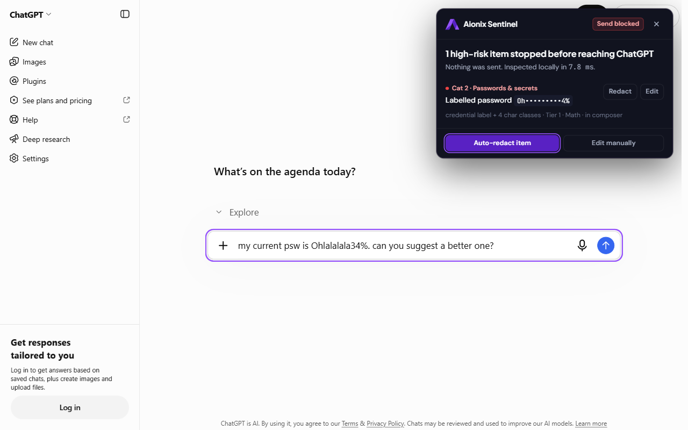
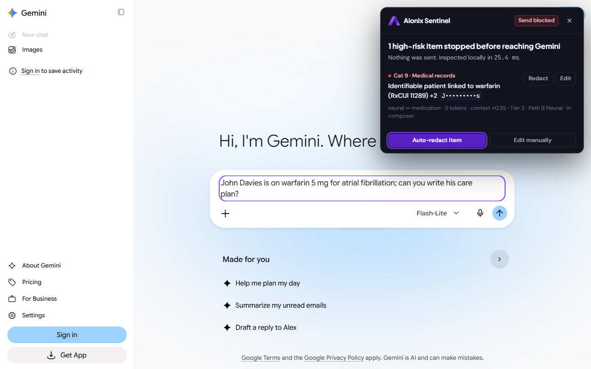
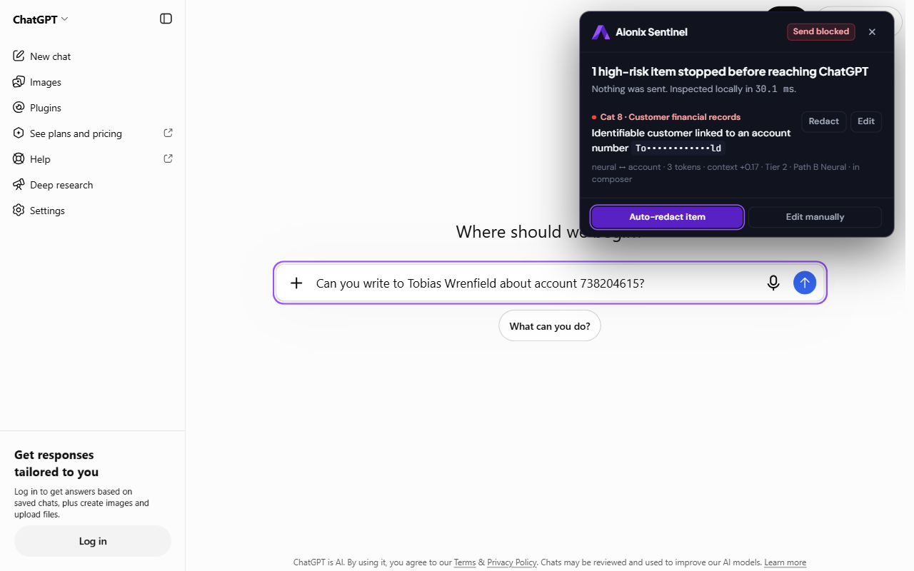
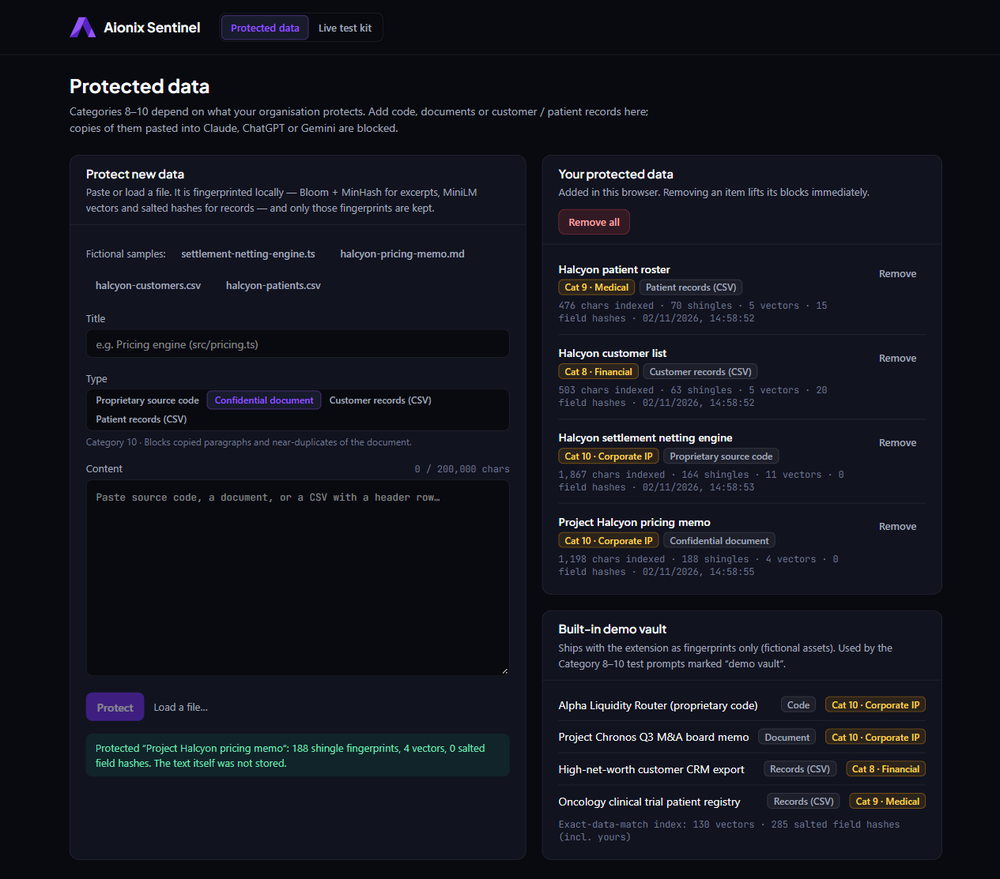
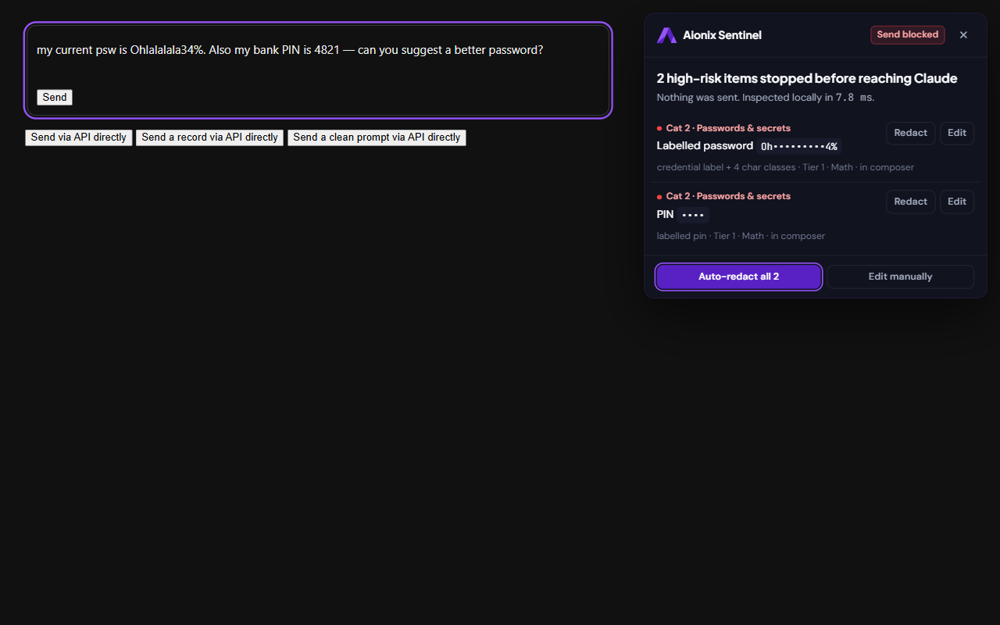
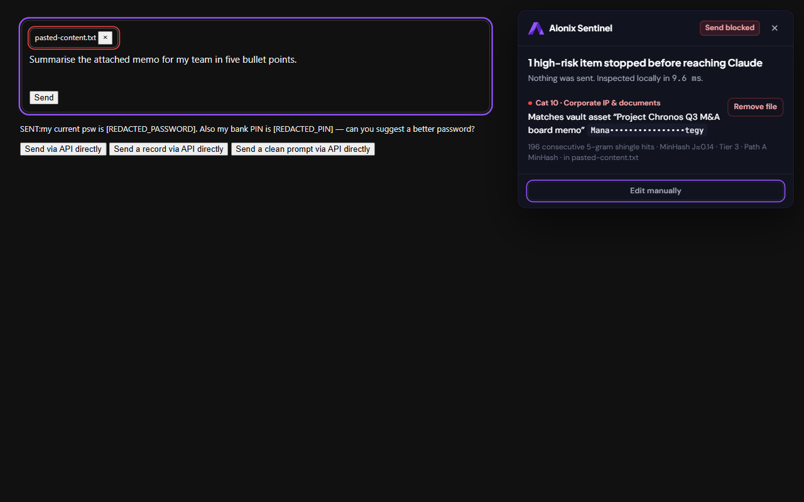

<p align="center">
  
</p>

<h1 align="center">Aionix Sentinel</h1>

<p align="center">Enterprise AI prompt guard: a Manifest V3 Chrome extension with a 3-tier local DLP engine and an operational benchmarking workbench.</p>

---

Aionix Sentinel inspects what employees type or paste into **Claude.ai**, **ChatGPT** and **Gemini**. It blocks high-risk corporate data before any byte leaves the browser. All inspection runs locally: there is no server round-trip and no remote code.

## What's inside

| Surface | Description |
|---|---|
| **Chrome extension (MV3)** | Isolated-world content script (Tier 1 + Tier 3A), MAIN-world `fetch`/XHR backstop, background service worker, offscreen inference document (Tier 2 + Tier 3B), branded popup, Shadow DOM block drawer with one-click redaction, and an options page to protect your own code, documents and customer/patient records plus a copy-ready live test kit |
| **Workbench** | Live Sandbox · Corporate Vault · Benchmarks · Telemetry · Extension Source & ZIP · Stakeholder Presentation |

## Detection engine

| Tier | Categories | How |
|---|---|---|
| **Tier 1**: deterministic & mathematical (sync, content script) | 1–7: API keys, passwords/secrets, government IDs, AU TFN, cards/bank, ABN/PAN/Aadhaar, DB credentials | Offset-preserving normalizer, O(n) pattern automata, Luhn (test cards exempt), TFN Mod-11, ABN Mod-89, Aadhaar Verhoeff, IBAN Mod-97, Shannon entropy. Password labels in 15 languages and the way people type them in English (`psw`, `pw`, `pass`, "password for X is", "changed my password to", Wi-Fi keys, "is Summer2024! strong enough?"), PINs, one-time and access codes; `.env` key names, connection-URL `password=` parameters, labelled bank accounts in a banking context, AU Medicare; values inside code blocks, JSON, YAML and CSV |
| **Tier 2 Path A**: lexicon-automata (CPU, always on) | 8–9: customer financial and medical records tied to a person | ICD-10-CM + RxNorm + curated lay terms compiled into an FST; 30-token person ↔ term proximity graph; a record role ("patient", "customer" …) or record ID decides, otherwise the MiniLM-L6 INT8 context validator |
| **Tier 2 Path B**: neural tagger (CPU, packaged) | 8–9, and 2–6 when rules confirm | Multilingual MiniLM token classifier (6 layers, vocabulary trimmed to 30k pieces, INT8, 22.9 MB) trained on permissively licensed synthetic PII plus synthetic credential-in-prose data (v3). Names, record IDs and account numbers feed the same graph and validator; **secrets and government IDs it proposes count only when the rules confirm them** (a password-shaped whole token or a credential word within 6 words; a checksum, ID structure or ID label), so a password stated without a label ("the password for it. Usually it is admin") is caught. Degrades to Path A on load failure or memory pressure |
| **Tier 3 Path A**: document fingerprinting (sync) | 10: corporate IP | 5-gram shingles, Bloom filter + 64-permutation MinHash over `corporate-vault.bin` |
| **Tier 3 Path B**: exact data match (offscreen) | 8, 9, 10 | Orama in-memory vector index (MiniLM embeddings, cosine > 0.95) + salted customer / patient field hashes |

The design decisions, memory budgets and trade-offs are in [docs/architecture.md](docs/architecture.md).

## Quick start

```bash
npm install
npm run data:models && npm run data:datasets   # MiniLM INT8 + ONNX Runtime wasm, benchmark datasets (network)
npm run dev                                    # Workbench at http://localhost:5173
npm run build                                  # dist-extension/ (load unpacked) + dist/ (Workbench)
```

The compiled engine indexes (`assets/engine/*`) are committed. `npm run setup` rebuilds everything from source: the ICD-10-CM / RxNorm FST, the vault indexes and the icons.

To install the extension: open `chrome://extensions`, enable **Developer mode**, choose **Load unpacked**, then select `dist-extension/`.

## Live testing in Chrome

1. **Load the extension** (above). Pin it, then open the popup: it shows the Tier 2 route (`Path B · Neural tagger (CPU)` once loaded), offscreen memory against the 150 MB ceiling, counters, and when the engine was loaded. The engine loads once (at browser start or install) and stays loaded for every tab; opening the popup or switching portals does not restart it.
2. **Open "Protected data & test kit"** from the popup (or right-click the icon → Options).
   - **Live test kit** tab: copy-ready prompts for every category 1–10 and all 24 stakeholder edge cases, each with the expected outcome and the tier that decides it.
   - **Protected data** tab: Categories 8–10 depend on what your organisation protects. Load one of the four fictional samples (code, memo, customer CSV, patient CSV) and press **Protect**. Only fingerprints are stored — never the text.
3. **Paste a prompt into claude.ai, chatgpt.com or gemini.google.com and press Enter.** A high-risk prompt is stopped before anything leaves the browser: the drawer lists each finding (masked), with **Auto-redact**, per-item **Redact** / **Edit**, and **Remove file** for flagged pasted-content chips. A clean prompt is sent normally.

**Every way a prompt can leave is checked:**

| Route | Where it is checked |
|---|---|
| Enter, the Send button or a form submit in the composer | Content script, before the portal sees the event |
| The plain input ChatGPT, Claude and Gemini show until their app has loaded (a first message typed straight after opening the page) | Same check: the composer is resolved from the element the key was pressed in |
| A long paste on signed-in ChatGPT (it uploads a paste of 10,000+ characters as `Pasted text.txt` the moment it is added; 5,000 is reported on some plans) | At paste time, from 5,000 characters, with the full cascade; a flagged paste never enters the composer |
| A long paste on Claude (a "Pasted text" chip that travels with the message), Gemini or signed-out ChatGPT (inline text; nothing is uploaded before Send) | On Send; removing a Claude chip lifts the block |
| Anything else that reaches the portal's send endpoint (an edited message, a retry, a script) | The MAIN-world network backstop runs the same cascade before the request leaves |

| Stakeholder report, live ChatGPT | Named patient, live Gemini (Tier 2 neural) |
|---|---|
|  |  |
| **Your protected customer CSV, live ChatGPT (Tier 3 EDM)** | **Options page: protected data** |
|  |  |
| **Drawer actions (Claude replica)** | **Large paste chip blocked, then removed** |
|  |  |

**The stakeholder's edge-case list, and where to try each one** (kit = options page → *Live test kit*):

| The brief says we will test… | Try | Expected | Live evidence |
|---|---|---|---|
| Large pastes that Claude and ChatGPT turn into attachment chips; removing the chip lifts the block | Kit · 10 · "Large paste → pasted-content chip": **Copy attachment** (about 22,000 characters, past every portal's chip threshold), Ctrl+V, add the prompt, Enter | **Claude:** a "Pasted text" chip; Send blocked "in pasted-content.txt" → **Remove file** → "Block lifted". **Gemini / signed-out ChatGPT:** the paste stays in the composer as text; Send is blocked. **Signed-in ChatGPT:** checked as you paste; "The paste was not added, and nothing was uploaded" | [Claude replica chip](docs/live-test/55-claude-replica-chip-blocked.png) → [removed](docs/live-test/56-claude-replica-chip-removed.png); live [ChatGPT](docs/live-test/29-chatgpt-large-paste.png) and [Gemini](docs/live-test/37-gemini-large-paste.png) (signed out: paste kept, Send blocked) |
| A sensitive item buried in a long prompt | Kit · edge cases · EC23 | Blocked; the drawer masks only that token | Edge-case suite (`npm test`) |
| Benign look-alikes: `4242 4242 4242 4242`, code naming a password field, order numbers, public figures, general medical / finance questions | Kit "Expect: sent" prompts in categories 2, 5, 8, 9 · EC06, EC11, EC12, EC18, EC19, EC21 | Sent untouched | [Code that reads a password from the environment, sent to live Gemini](docs/live-test/35-gemini-allowed-code-password-field.png); [question answered by live ChatGPT](docs/live-test/24-chatgpt-allowed-question.png) |
| Values with spaces or dashes, in other languages, in code blocks, JSON or CSV, or an unlabelled password | Kit · 2 "Password inside a code block / JSON body", "Other language", "Unlabelled password"; 3 "SSN with spaces", "SSNs in a CSV"; 4 "TFN with dashes", "TFN inside JSON"; 5 "Card inside JSON"; 8/9 "… as JSON / CSV" | Blocked | [Unlabelled password](docs/live-test/26-chatgpt-cat2-unlabelled-password.png) · [password stated in prose, Path B v3](docs/live-test/36-chatgpt-cat2-default-credentials.png) · [customer JSON](docs/live-test/27-chatgpt-cat8-customer-json.png) · [SSNs in CSV](docs/live-test/28-chatgpt-cat3-ssn-csv.png) · [patients CSV on Gemini](docs/live-test/34-gemini-cat9-patients-csv.png) |
| Benign text mixed with one real secret | Kit · 1 "OpenAI key in code" · EC23 | Blocked; one finding | [OpenAI key](docs/live-test/12-chatgpt-cat1-openai-key.png) |
| The block can't be bypassed by sending again; the user can fix the prompt | Press Enter / click Send again while blocked; then **Auto-redact**, **Redact**, **Edit** or **Edit manually** | Every send is re-checked; a cleaned prompt sends | [Two findings](docs/live-test/50-claude-replica-two-findings.png) → [auto-redacted](docs/live-test/52-claude-replica-auto-redacted.png) → [sent](docs/live-test/53-claude-replica-sent-redacted.png); [direct `fetch` refused](docs/live-test/25-chatgpt-backstop.png); [patient record sent past the composer, stopped at the network layer](docs/live-test/58-claude-replica-backstop-record.png); [Enter before the page finished loading](docs/live-test/59-chatgpt-replica-early-input.png) |

**Timing.** Enter → decision through the real content script: a clean prompt is sent in 20 ms p50 (max 37 ms) on Path B, a Tier 2 block shows in 31 ms p50 (max 53 ms), against a 1,000 ms budget counted from the Send event (`npm run measure:ext`, ADR-005).

All screenshots come from `npx tsx scripts/capture-live-guide.ts`, which drives the built extension on **live chatgpt.com and gemini.google.com (signed out)** and on the local Claude replica (claude.ai needs a sign-in). Its network guard aborts any request that carries a should-be-blocked prompt; per-trial outcomes and any such request are recorded in `docs/live-test/capture-results.json`.

## Quality gates

```bash
npm run typecheck
npm test                                     # unit suites + the 24 edge cases through the full cascade
npm run bench:gate                           # all datasets, full cascade, Path A → bench-results/path-a.json
npm run bench:gate -- --path-b               # same with Tier 2 on the shipped Path B tagger → path-b.json
npm run build:ext:test && npm run test:e2e   # Playwright drives the real extension on portal fixtures
```

`.github/workflows/release-gate.yml` runs the same gates in CI.

In-extension memory and latency come from `npm run build:ext:test && npm run measure:ext` (add `-- --path-a-only` for the Path B-evicted fallback state); `npm run report` regenerates the results section below from `bench-results/`.

## Path B model pipeline

The Path B tagger in `assets/engine/pathb/` is built by `scripts/ml/` (Python 3.13 venv at `.venv`, PyTorch with CUDA). Each step writes to the gitignored `.cache/ml/`. See ADR-007 in [docs/architecture.md](docs/architecture.md).

```bash
python -m venv .venv && .venv/Scripts/pip install torch --index-url https://download.pytorch.org/whl/cu128
.venv/Scripts/pip install transformers datasets onnx onnxruntime huggingface_hub safetensors sentencepiece seqeval
cd scripts/ml
../../.venv/Scripts/python build_corpus.py        # Nemotron-PII (CC BY 4.0) + Gretel multilingual (Apache-2.0)
../../.venv/Scripts/python trim_vocab.py <Multilingual-MiniLM dir> <XLM-R tokenizer.json> <out> --top 30000
../../.venv/Scripts/python train_ner.py <trimmed dir> <out> --layers 6 --epochs 3 --lr 1e-4
../../.venv/Scripts/python export_onnx.py <out> --per-channel            # fp32 + INT8, parity report
../../.venv/Scripts/python tag_datasets.py <out> --name <id>             # dev splits only
cd ../.. && npx tsx scripts/bakeoff.ts <id> ...                          # compare inside the real cascade
.venv/Scripts/python scripts/ml/package_pathb.py <out>                   # → assets/engine/pathb
```

> Every figure shown in the Benchmarks, Telemetry and Presentation workspaces comes from an actual run of the shipping engine. Design targets from the original plan are shown only as labelled targets.

## Measured results

<!-- results:start -->
Document-level detection, positive = "must block". **Dev** splits were used for error analysis while developing rules and for selecting the Path B model (optimistic); **held-out** splits were never inspected or tuned on. Both paths: the full cascade in Node on the same machine.

| Dataset | Split | n | Path A P / R | Path A F2 | Path A FPR | Path A p50 / p95 | Path B P / R | Path B F2 | Path B FPR | Path B p50 / p95 |
|---|---|---:|---:|---:|---:|---:|---:|---:|---:|---:|
| 24 Stakeholder Edge Cases | curated | 25 | 1.000 / 1.000 | 1.000 | 0.00% | 5.5 ms / 35 ms | 1.000 / 1.000 | 1.000 | 0.00% | 9.4 ms / 60 ms |
| English Disclosure Probes | curated | 137 | 1.000 / 1.000 | 1.000 | 0.00% | 0.2 ms / 5.1 ms | 1.000 / 1.000 | 1.000 | 0.00% | 2.6 ms / 9.3 ms |
| Contextual Challenge Set | curated | 103 | 0.941 / 0.627 | 0.672 | 3.85% | 0.3 ms / 8.2 ms | 0.935 / 0.843 | 0.860 | 5.77% | 2.7 ms / 13 ms |
| Enron Email Corpus | dev | 300 | 1.000 / 1.000 | 1.000 | 0.00% | 29 ms / 121 ms | 0.500 / 1.000 | 0.833 | 0.33% | 47 ms / 242 ms |
| Presidio Synthetic PII | dev | 488 | 1.000 / 1.000 | 1.000 | 0.00% | 3.1 ms / 6.8 ms | 1.000 / 1.000 | 1.000 | 0.00% | 6.9 ms / 13 ms |
| AI4Privacy Multilingual | dev | 584 | 0.993 / 0.818 | 0.848 | 0.24% | 8.0 ms / 14 ms | 0.951 / 0.912 | 0.919 | 1.93% | 15 ms / 25 ms |
| Enron · held-out | holdout | 300 | 0.200 / 1.000 | 0.556 | 1.34% | 27 ms / 100 ms | 0.143 / 1.000 | 0.455 | 2.01% | 54 ms / 216 ms |
| AI4Privacy · held-out | holdout | 500 | 0.898 / 0.646 | 0.685 | 1.44% | 8.2 ms / 15 ms | 0.813 / 0.793 | 0.797 | 3.59% | 15 ms / 25 ms |

Design targets (F2 ≥ 0.978, FPR < 0.02%) on Path A: met on 24 Stakeholder Edge Cases, English Disclosure Probes, Enron Email Corpus, Presidio Synthetic PII; **not met on Contextual Challenge Set, AI4Privacy Multilingual, Enron · held-out, AI4Privacy · held-out.**
Design targets (F2 ≥ 0.978, FPR < 0.02%) on Path B: met on 24 Stakeholder Edge Cases, English Disclosure Probes, Presidio Synthetic PII; **not met on Contextual Challenge Set, Enron Email Corpus, AI4Privacy Multilingual, Enron · held-out, AI4Privacy · held-out.**

**English only.** AI4Privacy rows the dataset annotates as English. Enron, Presidio, the edge cases and the probes are English throughout.

| Subset | n | Path A P / R | Path A F2 | Path A FPR | Path B P / R | Path B F2 | Path B FPR |
|---|---:|---:|---:|---:|---:|---:|---:|
| AI4Privacy dev · English | 100 | 0.941 / 0.696 | 0.734 | 1.30% | 0.850 / 0.739 | 0.759 | 3.90% |
| AI4Privacy held-out · English | 100 | 0.857 / 0.600 | 0.638 | 2.50% | 0.778 / 0.700 | 0.714 | 5.00% |

- **Path B vs Path A, held-out.** AI4Privacy (80% French, German and Italian) recall 0.646 → 0.793, F2 0.685 → 0.797, FPR 1.44% → 3.59%. Enron FPR 1.34% → 2.01%.
- **Earlier Path B** (openai/privacy-filter (q4f16, WebGPU) · intel · gen-12lp, recorded 2026-10-30): held-out AI4Privacy F2 0.770 at FPR 14.83%; Enron FPR 6.35%. It needed 958 MB of host memory and was replaced (ADR-007).
- **Node runs:** Path A 2026-11-02, Path B 2026-11-02 (aionix-pathb-6L-v3 (Multilingual-MiniLM, trimmed vocab, INT8)); Node v22.14.0, 12th Gen Intel(R) Core(TM) i7-12700H. Latency is the whole cascade per observation.
- **Browser run (Path A):** recorded 2026-10-30 in the Workbench engine worker, ONNX Runtime wasm (CPU) · 20 logical cores; same detections as the Node run.
- **Inside the extension** (path-a-only (Path B evicted, recycled document), Chromium via Playwright): offscreen memory 87.1 MB (measureUserAgentSpecificMemory after forced GC (raw CDP, offscreen document)); Tier 2 route A, p50 / p95 0.1 ms / 2.2 ms; Tier 3B p50 / p95 6.3 ms / 8.7 ms.
  - Enter → decision, real content script on the fixture portal: clean prompt sent p50 15 ms / p95 34 ms / max 34 ms (n=12); Tier 2 block shown p50 24 ms / p95 45 ms / max 45 ms (n=5); Tier 1 block shown p50 10 ms / p95 21 ms / max 21 ms (n=5). Budget: 1,000 ms from Send.
- **Inside the extension** (auto (Path B allowed), Chromium via Playwright): offscreen memory 109.7 MB (measureUserAgentSpecificMemory after forced GC (raw CDP, offscreen document)); Tier 2 route B, p50 / p95 6.8 ms / 11 ms; Tier 3B p50 / p95 6.3 ms / 8.5 ms.
  - Path B ready after 169 ms: aionix-pathb-6L-v3 (Multilingual-MiniLM, trimmed vocab, INT8) · CPU (ONNX Runtime wasm) · host 111 MB after load (performance.memory JS heap + wasm linear memory).
  - Enter → decision, real content script on the fixture portal: clean prompt sent p50 21 ms / p95 37 ms / max 37 ms (n=12); Tier 2 block shown p50 29 ms / p95 52 ms / max 52 ms (n=5); Tier 1 block shown p50 9.9 ms / p95 16 ms / max 16 ms (n=5). Budget: 1,000 ms from Send.

**Path B bake-off** (model selection, 2026-11-02). Dev splits and the frozen contextual challenge set, full cascade. Each candidate under the shipped policy (`gated-0.85/6`: neural secrets / IDs count only when the rules confirm them) and, for reference, `graph` (v2: neural spans only feed the Category 8/9 graph). AI4Privacy FPR in brackets leaves out the rows that state a PIN or CVV, which the dataset labels low-risk and the engine blocks. Tagger latency is ONNX Runtime CPU with 4 threads, per text; xlmrb-v3-e1 was timed while the GPU was training.

| Candidate | Weights | Challenge recall / F2 · gated | AI4Privacy dev F2 / FPR · gated | AI4Privacy dev F2 / FPR · graph | Enron dev FPR · gated | Tagger p50 / p95 on Enron |
|---|---:|---:|---:|---:|---:|---:|
| Path A (no tagger) | — | 0.627 / 0.672 | — | 0.848 / 0.24% | 0.00% | — |
| aionix-l6 | 22.9 MB INT8 | 0.647 / 0.688 | 0.911 / 1.69% (0.72%) | 0.871 / 0.72% | 0.33% | 16 ms / 89 ms |
| aionix-l12 | 33.9 MB INT8 | 0.647 / 0.690 | 0.911 / 1.69% (0.72%) | 0.871 / 0.72% | 0.33% | 27 ms / 150 ms |
| aionix-l6-v3 | 22.9 MB INT8 | 0.843 / 0.860 | 0.919 / 1.93% (0.72%) | 0.871 / 0.72% | 0.33% | 16 ms / 87 ms |
| xlmrb-v3-e1-int8 | 110 MB INT8 | 0.804 / 0.830 | 0.896 / 1.69% (0.48%) | 0.862 / 0.48% | 0.33% | 234 ms / 1289 ms |
| xlmrb-v3-e2-int8 | 110 MB INT8 | 0.843 / 0.863 | 0.920 / 1.69% (0.48%) | 0.872 / 0.48% | 0.33% | 96 ms / 573 ms |
<!-- results:end -->

## Known limitations

- **Live portal DOM drift.** Selectors and prompt endpoints change without notice. On 2026-10-31 signed-out ChatGPT had moved to a `<textarea name="prompt">` and a form-encoded `/unauth-mweb/conversation/updates` request, and signed-in ChatGPT's composer had lost its `#prompt-textarea` id; the adapters were updated and the shapes added to the fixtures. Expect further drift — re-run the capture script and the read-only DOM checks.
- **When the offscreen check cannot answer** (engine starting, recycled or unreachable; past its budget: 1,000 ms, more for long pastes), a prompt that is clean on Tier 1/3A is **held** with *Send anyway* rather than sent silently (ADR-005). In one of four full live capture runs the engine became unreachable mid-session; the root cause is not yet identified.
- **Passwords stated without a label** are caught by Path B v3 when the tagger proposes the value and the rules confirm it: a password-shaped token ("I use Summer2024! for everything"), or a weak value within 6 words of a credential word ("the password for it. Usually it is admin"). Still missed on the frozen challenge set: pairs like "admin / admin" or "mike.r@gmail.com / bluefish44", a recovery phrase, a value 19 words from its cue ("…test with root"), "Für den Testserver nimm einfach admin". It also flags example bad passwords quoted in training material ("passwords like 123456 … are a bad idea"). Path A (no tagger) catches only labelled forms and strength questions.
- **Tier 2 cannot tell who has the condition.** A named colleague next to a condition in a work context ("Team member Sarah Lee will present our diabetes research") is blocked when the validator reads it as personal.
- **Long pastes** (measured 2026-11-02 with benign text and the browser's network log; nothing was sent). Claude turns a paste of 4,000–5,000+ characters into a "Pasted text" chip that travels inside the send request. Gemini (signed in and out) and signed-out ChatGPT keep long pastes as inline text and upload nothing before Send. **Signed-in ChatGPT** turns a paste of 10,000+ characters (Free; 5,000 is reported for Plus / Pro / Business) into `Pasted text.txt` and uploads the full text at once (`POST /backend-api/files` → `PUT` to `*.oaiusercontent.com/files/<id>/raw` → `process_upload_stream`). So only signed-in ChatGPT pastes of 5,000+ characters are checked at paste time; everything else is checked on Send. A plan that converts below 5,000 characters would upload such a paste before Send. Files added with the attach button are not inspected.
- **Long inputs take longer than 1 s to decide.** Path B needs about 0.045 ms per character (22,000 characters ≈ 1.0 s offscreen), so the Send budget is 1,000 ms up to 4,000 characters plus 0.1 ms per extra character, capped at 10 s (with a fixed 1 s, a clean long paste was held as "Check incomplete" or left to Path A). Routing long inputs to Path A would decide 60,000 characters in ~50 ms, but Path A's recall on the contextual challenge set is 0.627 against Path B's 0.843.
- **The network backstop trusts the page's DOM events.** A page script could forge the content script's "verified" signal; the threat model is accidental disclosure by employees, not a hostile portal.
- **Held-out recall on AI4Privacy is the weak spot for Path A.** Path B v3 raises held-out AI4Privacy recall 0.720 → 0.793 (F2 0.747 → 0.797) and lowers held-out Enron FPR 2.34% → 2.01%, but raises held-out AI4Privacy FPR 1.91% → 3.59%: 3 of the 15 false alarms are stated PINs / CVVs, which the dataset labels low-risk and the engine blocks on purpose (Category 2); the other 12 put it at 2.87%. On the English-only AI4Privacy rows it is slightly weaker than v2 (lone first names next to an account number are no longer linked).
- **Multilingual training data is thin** for Path B: about 4k synthetic finance documents per non-English language, plus ~4k synthetic credential sentences across French, German, Spanish and Italian.
- **Memory headroom.** With Path B loaded the offscreen document measures 110 MB, under the 150 MB ceiling but above the 105 MB warning watermark. MiniLM (validator + EDM) and the tagger are still two ONNX sessions; sharing one encoder is the next memory step.
- **Memory readings.** The extension offscreen document reports `measureUserAgentSpecificMemory()`. A plain Web Worker cannot, so the Workbench reports page + worker together.

## Project structure

```
.github/workflows/release-gate.yml   CI: typecheck → unit → both bench gates → build → e2e
assets/
  brand/aionix-mark.svg              logo mark
  engine/                            committed runtime binaries
    medical.fst.bin (+ .json)        ICD-10-CM + RxNorm + lay terms, 65,938 entries, 3.4 MB
    corporate-vault.bin              Tier 3A Bloom + MinHash of the demo vault
    vault-edm.bin                    Tier 3B vectors + salted field hashes of the demo vault
    pathb/                           Path B tagger: model_int8.onnx (22.9 MB), tokenizer, labels, NOTICE
    test-kit.json                    options-page live test kit (generated)
  icons/                             16 / 32 / 48 / 128 px
  models/, ort/                      fetched, gitignored: MiniLM-L6 INT8, ONNX Runtime wasm
bench-gate.json                      CI thresholds (Path A, and "pathB")
bench-results/                       every measured result (Node runs, browser runs, extension, bake-off)
data/
  datasets/                          edge cases, English probes, Enron (+ adjudications), Presidio; AI4Privacy fetched
  lexicons/                          first names, surnames, public figures, medical synonyms / stoplist, financial terms
  test-kit/                          fictional samples to protect + the large-paste filler
  vault/                             demo vault: proprietary router, board memo, CRM export, trial registry
docs/
  architecture.md                    category taxonomy, ADR-001 … ADR-008
  datasets.md, edge-cases.md         dataset licences / splits, the 24 acceptance scenarios
  live-test/                         live screenshots, capture-results.json, audit-sample.json
scripts/
  build-extension.mjs, vite-extension-files.ts   extension build (prod + test)
  build-medical-fst.ts, build-vault.ts, build-test-kit.ts, gen-icons.mjs, fetch-*.{ts,mjs}
  bench.ts, report-results.ts, bakeoff.ts, measure-extension.ts, capture-live-guide.ts
  datasets/                          edge-case, probe and synthetic-value generators
  lib/                               Node engine, embedder and tagger (benchmarks run the shipping engine)
  ml/                                Python Path B pipeline: corpus → vocab trim → train → ONNX/INT8 → package
src/
  engine/                            pure TypeScript, no DOM or chrome.*
    tier1/                           normaliser candidates, patterns, secrets, checksums, entropy
    tier2/                           FST, nodes, proximity graph, validator, lexicon + neural paths
    tier3/                           shingles, Bloom, MinHash, EDM, custom (protected) vault
    embed/, runtime/                 tokenizers, MiniLM / tagger on ONNX Runtime
    pipeline.ts, host.ts, memory-governor.ts, redact.ts, telemetry.ts, digest.ts, types.ts
    bench/                           harness, metrics, dataset registry
  extension/
    content/                         content script, interceptor core, drawer, attachment store, adapters/
    main-world-interceptor.ts        fetch / XHR network backstop
    background-sw.ts, offscreen-onnx-worker.ts, popup.tsx, options.tsx, messages.ts, manifest.json
  shared/brand/                      logo paths, tokens, <AionixLogo/>
  workbench/                         React 19 Workbench: 6 workspaces, zustand stores, engine worker
tests/
  unit/                              10 vitest suites (521 tests)
  e2e/                               Playwright: extension.spec.ts, portal fixture, fixture server
```

## Datasets & licences

Benchmark corpora and vocabularies (Enron, Presidio, AI4Privacy, ICD-10-CM, RxNorm, MiniLM) are documented in [docs/datasets.md](docs/datasets.md), including licence notes and labelling policy.
