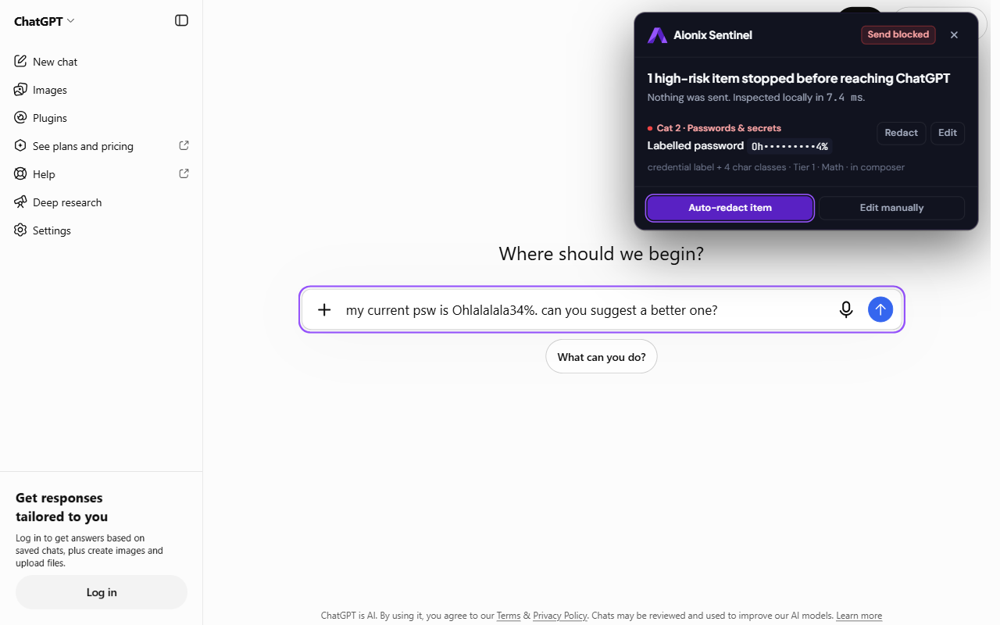
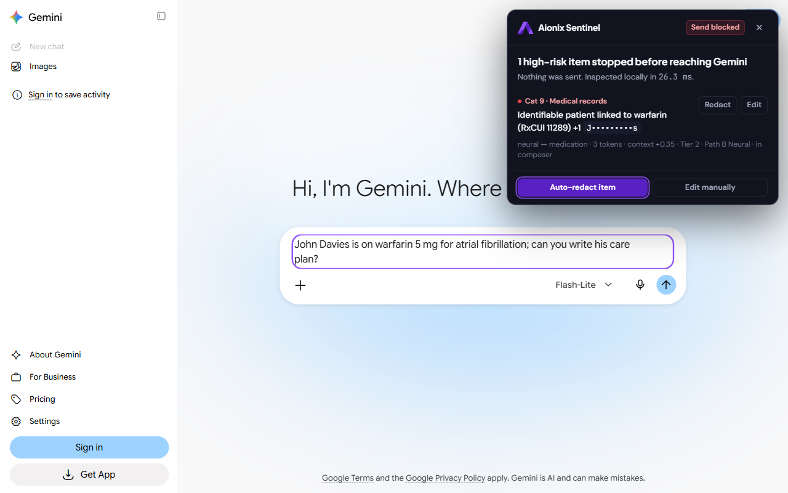
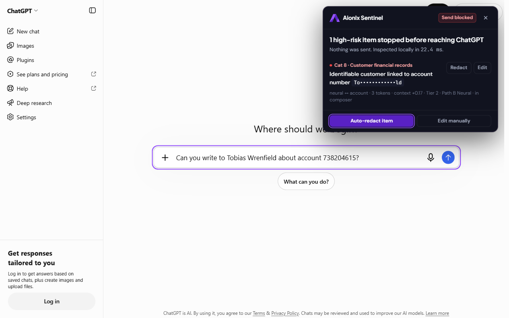
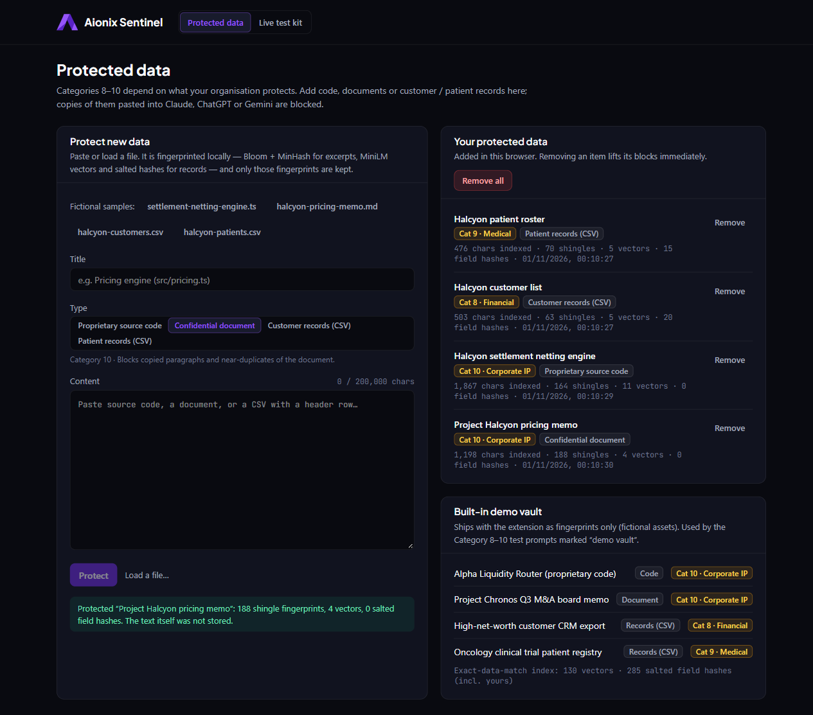
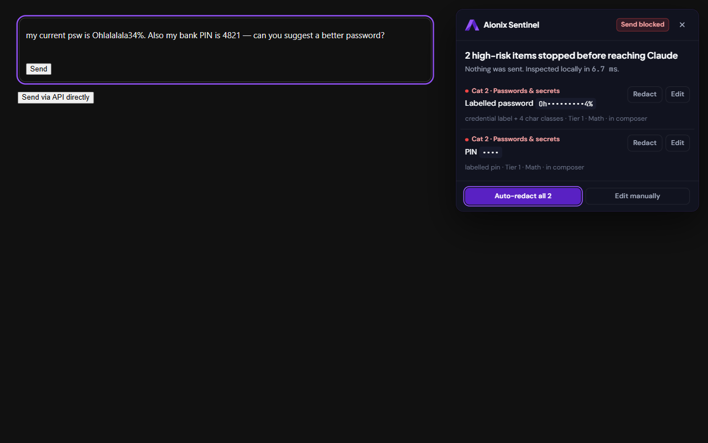
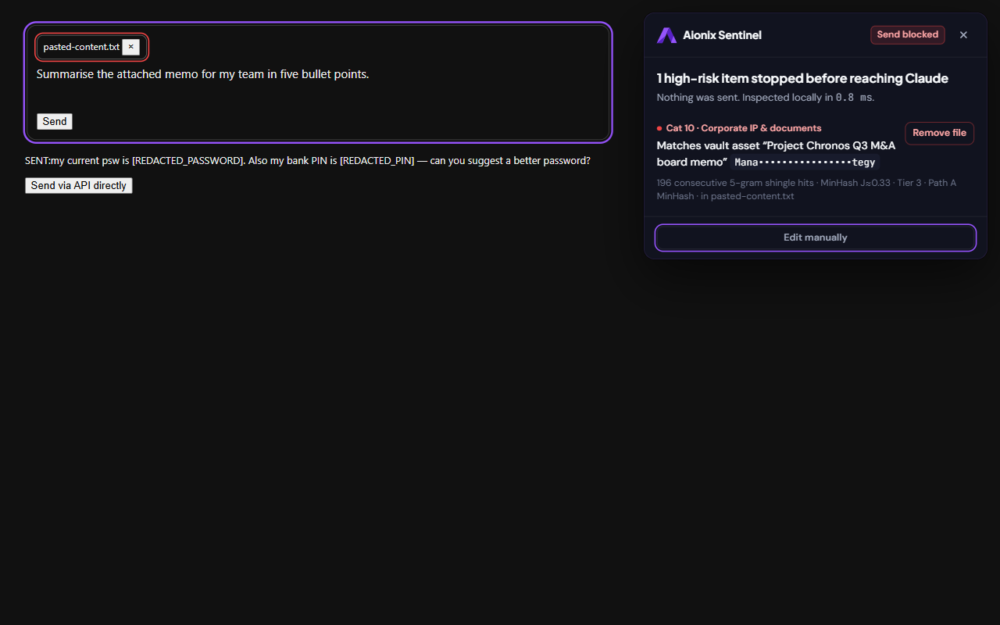

<p align="center">
  
</p>

<h1 align="center">Aionix Sentinel</h1>

<p align="center">Enterprise AI prompt guard: a Manifest V3 Chrome extension with a 3-tier local DLP engine and an operational benchmarking workbench.</p>

---

Aionix Sentinel inspects what employees type or paste into **Claude.ai**, **ChatGPT** and **Gemini**. It blocks high-risk corporate data before any byte leaves the browser. All inspection runs locally: there is no server round-trip and no remote code.

## What's inside

| Surface | Description |
|---|---|
| **Chrome extension (MV3)** | Isolated-world content script (Tier 1 + Tier 3A), MAIN-world `fetch`/XHR backstop, background service worker, offscreen inference document (Tier 2 + Tier 3B), branded popup, Shadow DOM block drawer with one-click redaction, and an options page to protect your own code, documents and customer/patient records plus a copy-ready live test kit |
| **Workbench** | Live Sandbox · Corporate Vault · Benchmarks · Telemetry · Extension Source & ZIP · Stakeholder Presentation |

## Detection engine

| Tier | Categories | How |
|---|---|---|
| **Tier 1**: deterministic & mathematical (sync, content script) | 1–7: API keys, passwords/secrets, government IDs, AU TFN, cards/bank, ABN/PAN/Aadhaar, DB credentials | Offset-preserving normalizer, O(n) pattern automata, Luhn (test cards exempt), TFN Mod-11, ABN Mod-89, Aadhaar Verhoeff, IBAN Mod-97, Shannon entropy. Password labels in 15 languages and the way people type them in English (`psw`, `pw`, `pass`, "password for X is", "changed my password to", Wi-Fi keys), PINs, one-time and access codes |
| **Tier 2 Path A**: lexicon-automata (CPU, always on) | 8–9: customer financial and medical records tied to a person | ICD-10-CM + RxNorm compiled into an FST; 30-token person ↔ term proximity graph; MiniLM-L6 INT8 context validator |
| **Tier 2 Path B**: neural tagger (CPU, packaged) | 8–9 | Multilingual MiniLM token classifier (6 layers, vocabulary trimmed to 30k pieces, INT8, 22.9 MB) trained on permissively licensed synthetic PII. It finds names, record IDs and account numbers; the same graph and validator decide. Degrades to Path A on load failure or memory pressure |
| **Tier 3 Path A**: document fingerprinting (sync) | 10: corporate IP | 5-gram shingles, Bloom filter + 64-permutation MinHash over `corporate-vault.bin` |
| **Tier 3 Path B**: exact data match (offscreen) | 8, 10 | Orama in-memory vector index (MiniLM embeddings, cosine > 0.95) + salted CRM tuple hashes |

The design decisions, memory budgets and trade-offs are in [docs/architecture.md](docs/architecture.md).

## Quick start

```bash
npm install
npm run data:models && npm run data:datasets   # MiniLM INT8 + ONNX Runtime wasm, benchmark datasets (network)
npm run dev                                    # Workbench at http://localhost:5173
npm run build                                  # dist-extension/ (load unpacked) + dist/ (Workbench)
```

The compiled engine indexes (`assets/engine/*`) are committed. `npm run setup` rebuilds everything from source: the ICD-10-CM / RxNorm FST, the vault indexes and the icons.

To install the extension: open `chrome://extensions`, enable **Developer mode**, choose **Load unpacked**, then select `dist-extension/`.

## Live testing in Chrome

1. **Load the extension** (above). Pin it, then open the popup: it shows the Tier 2 route (`Path B · Neural tagger (CPU)` once loaded), offscreen memory against the 150 MB ceiling, and counters.
2. **Open "Protected data & test kit"** from the popup (or right-click the icon → Options).
   - **Live test kit** tab: copy-ready prompts for every category 1–10 and all 24 stakeholder edge cases, each with the expected outcome and the tier that decides it.
   - **Protected data** tab: Categories 8–10 depend on what your organisation protects. Load one of the four fictional samples (code, memo, customer CSV, patient CSV) and press **Protect**. Only fingerprints are stored — never the text.
3. **Paste a prompt into claude.ai, chatgpt.com or gemini.google.com and press Enter.** A high-risk prompt is stopped before anything leaves the browser: the drawer lists each finding (masked), with **Auto-redact**, per-item **Redact** / **Edit**, and **Remove file** for flagged pasted-content chips. A clean prompt is sent normally.

| Stakeholder report, live ChatGPT | Named patient, live Gemini (Tier 2 neural) |
|---|---|
|  |  |
| **Your protected customer CSV, live ChatGPT (Tier 3 EDM)** | **Options page: protected data** |
|  |  |
| **Drawer actions (Claude replica)** | **Large paste chip blocked, then removed** |
|  |  |

All screenshots come from `npx tsx scripts/capture-live-guide.ts`, which drives the built extension on **live chatgpt.com and gemini.google.com (signed out)** and on the local Claude replica (claude.ai needs a sign-in). Its network guard aborts any request that carries a should-be-blocked prompt; the last run recorded 20 of 20 trials as expected and no such request (`docs/live-test/capture-results.json`).

## Quality gates

```bash
npm run typecheck
npm test                                     # unit suites + the 24 edge cases through the full cascade
npm run bench:gate                           # all datasets, full cascade, Path A → bench-results/path-a.json
npm run bench:gate -- --path-b               # same with Tier 2 on the shipped Path B tagger → path-b.json
npm run build:ext:test && npm run test:e2e   # Playwright drives the real extension on portal fixtures
```

`.github/workflows/release-gate.yml` runs the same gates in CI.

In-extension memory and latency come from `npm run build:ext:test && npm run measure:ext` (add `-- --path-a-only` for the Path B-evicted fallback state); `npm run report` regenerates the results section below from `bench-results/`.

## Path B model pipeline

The Path B tagger in `assets/engine/pathb/` is built by `scripts/ml/` (Python 3.13 venv at `.venv`, PyTorch with CUDA). Each step writes to the gitignored `.cache/ml/`. See ADR-007 in [docs/architecture.md](docs/architecture.md).

```bash
python -m venv .venv && .venv/Scripts/pip install torch --index-url https://download.pytorch.org/whl/cu128
.venv/Scripts/pip install transformers datasets onnx onnxruntime huggingface_hub safetensors sentencepiece seqeval
cd scripts/ml
../../.venv/Scripts/python build_corpus.py        # Nemotron-PII (CC BY 4.0) + Gretel multilingual (Apache-2.0)
../../.venv/Scripts/python trim_vocab.py <Multilingual-MiniLM dir> <XLM-R tokenizer.json> <out> --top 30000
../../.venv/Scripts/python train_ner.py <trimmed dir> <out> --layers 6 --epochs 3 --lr 1e-4
../../.venv/Scripts/python export_onnx.py <out> --per-channel            # fp32 + INT8, parity report
../../.venv/Scripts/python tag_datasets.py <out> --name <id>             # dev splits only
cd ../.. && npx tsx scripts/bakeoff.ts <id> ...                          # compare inside the real cascade
.venv/Scripts/python scripts/ml/package_pathb.py <out>                   # → assets/engine/pathb
```

> Every figure shown in the Benchmarks, Telemetry and Presentation workspaces comes from an actual run of the shipping engine. Blueprint targets are shown only as labelled targets.

## Measured results

<!-- results:start -->
Document-level detection, positive = "must block". **Dev** splits were used for error analysis while developing rules and for selecting the Path B model (optimistic); **held-out** splits were never inspected or tuned on. Both paths: the full cascade in Node on the same machine.

| Dataset | Split | n | Path A P / R | Path A F2 | Path A FPR | Path A p50 / p95 | Path B P / R | Path B F2 | Path B FPR | Path B p50 / p95 |
|---|---|---:|---:|---:|---:|---:|---:|---:|---:|---:|
| 24 Stakeholder Edge Cases | curated | 25 | 1.000 / 1.000 | 1.000 | 0.00% | 5.8 ms / 36 ms | 1.000 / 1.000 | 1.000 | 0.00% | 9.3 ms / 52 ms |
| English Disclosure Probes | curated | 98 | 1.000 / 1.000 | 1.000 | 0.00% | 0.2 ms / 6.0 ms | 1.000 / 1.000 | 1.000 | 0.00% | 2.6 ms / 9.4 ms |
| Enron Email Corpus | dev | 300 | 1.000 / 1.000 | 1.000 | 0.00% | 29 ms / 116 ms | 0.500 / 1.000 | 0.833 | 0.33% | 44 ms / 187 ms |
| Presidio Synthetic PII | dev | 488 | 1.000 / 1.000 | 1.000 | 0.00% | 3.0 ms / 6.9 ms | 1.000 / 1.000 | 1.000 | 0.00% | 5.5 ms / 11 ms |
| AI4Privacy Multilingual | dev | 584 | 1.000 / 0.812 | 0.844 | 0.00% | 7.9 ms / 14 ms | 0.986 / 0.841 | 0.867 | 0.48% | 12 ms / 19 ms |
| Enron · held-out | holdout | 300 | 0.200 / 1.000 | 0.556 | 1.34% | 28 ms / 103 ms | 0.143 / 1.000 | 0.455 | 2.01% | 40 ms / 160 ms |
| AI4Privacy · held-out | holdout | 500 | 0.898 / 0.646 | 0.685 | 1.44% | 8.2 ms / 15 ms | 0.881 / 0.720 | 0.747 | 1.91% | 12 ms / 20 ms |

Blueprint targets (F2 ≥ 0.978, FPR < 0.02%) on Path A: met on 24 Stakeholder Edge Cases, English Disclosure Probes, Enron Email Corpus, Presidio Synthetic PII; **not met on AI4Privacy Multilingual, Enron · held-out, AI4Privacy · held-out.**
Blueprint targets (F2 ≥ 0.978, FPR < 0.02%) on Path B: met on 24 Stakeholder Edge Cases, English Disclosure Probes, Presidio Synthetic PII; **not met on Enron Email Corpus, AI4Privacy Multilingual, Enron · held-out, AI4Privacy · held-out.**

**English only.** AI4Privacy rows the dataset annotates as English. Enron, Presidio, the edge cases and the probes are English throughout.

| Subset | n | Path A P / R | Path A F2 | Path A FPR | Path B P / R | Path B F2 | Path B FPR |
|---|---:|---:|---:|---:|---:|---:|---:|
| AI4Privacy dev · English | 100 | 1.000 / 0.652 | 0.701 | 0.00% | 0.947 / 0.783 | 0.811 | 1.30% |
| AI4Privacy held-out · English | 100 | 0.857 / 0.600 | 0.638 | 2.50% | 0.875 / 0.700 | 0.729 | 2.50% |

- **Path B vs Path A, held-out.** AI4Privacy (80% French, German and Italian) recall 0.646 → 0.720, F2 0.685 → 0.747, FPR 1.44% → 1.91%. Enron FPR 1.34% → 2.01%.
- **Earlier Path B** (openai/privacy-filter (q4f16, WebGPU) · intel · gen-12lp, recorded 2026-10-30): held-out AI4Privacy F2 0.770 at FPR 14.83%; Enron FPR 6.35%. It needed 958 MB of host memory and was replaced (ADR-007).
- **Node runs:** Path A 2026-10-31, Path B 2026-10-31 (aionix-pathb-6L (Multilingual-MiniLM, trimmed vocab, INT8)); Node v22.14.0, 12th Gen Intel(R) Core(TM) i7-12700H. Latency is the whole cascade per observation.
- **Browser run (Path A):** recorded 2026-10-30 in the Workbench engine worker, ONNX Runtime wasm (CPU) · 20 logical cores; same detections as the Node run.
- **Inside the extension** (path-a-only (Path B evicted, recycled document), Chromium via Playwright): offscreen memory 87.1 MB (measureUserAgentSpecificMemory after forced GC (raw CDP, offscreen document)); Tier 2 route A, p50 / p95 6.1 ms / 9.3 ms; Tier 3B p50 / p95 0.2 ms / 5.8 ms.
- **Inside the extension** (auto (Path B allowed), Chromium via Playwright): offscreen memory 110.3 MB (measureUserAgentSpecificMemory after forced GC (raw CDP, offscreen document)); Tier 2 route B, p50 / p95 13 ms / 18 ms; Tier 3B p50 / p95 0.2 ms / 6.1 ms.
  - Path B ready after 173 ms: aionix-pathb-6L (Multilingual-MiniLM, trimmed vocab, INT8) · CPU (ONNX Runtime wasm) · host 118 MB after load (measureUserAgentSpecificMemory).

**Path B bake-off** (model selection, 2026-10-30). Dev splits only, `graph` policy, full cascade. Recorded before the English Tier 1 fixes, which changed both paths equally. Tagger latency is ONNX Runtime CPU with 4 threads, per text.

| Candidate | Weights | INT8 vs fp32 token agreement | AI4Privacy dev F2 / FPR | Enron dev FPR | Presidio dev F2 | Tagger p50 / p95 on Enron |
|---|---:|---:|---:|---:|---:|---:|
| Path A (no tagger) | — | — | 0.844 / 0.00% | 0.00% | 1.000 | — |
| aionix-l6 | 22.9 MB INT8 | 99.95% | 0.867 / 0.48% | 0.33% | 1.000 | 15 ms / 79 ms |
| aionix-l12 | 33.9 MB INT8 | 99.87% | 0.867 / 0.48% | 0.33% | 1.000 | 27 ms / 146 ms |
| openmed-e5small-int8 | 34 MB INT8 | 99.46% | 0.876 / 0.72% | 0.67% | 1.000 | 32 ms / 158 ms |
| ettin32m-int8 | 32.6 MB INT8 | 91.44% | 0.853 / 0.24% | 0.00% | 0.999 | 25 ms / 119 ms |
| ettin17m-int8 | 17.2 MB INT8 | 85.34% | 0.849 / 0.00% | 0.00% | 1.000 | 14 ms / 60 ms |
| ettin17m-fp32 | 67.7 MB fp32 | n/a (fp32) | 0.856 / 0.72% | 0.33% | 0.999 | 18 ms / 82 ms |
<!-- results:end -->

## Known limitations

- **Live portal DOM drift.** Selectors and prompt endpoints change without notice. On 2026-10-31 signed-out ChatGPT had moved to a `<textarea name="prompt">` and a form-encoded `/unauth-mweb/conversation/updates` request, and signed-in ChatGPT's composer had lost its `#prompt-textarea` id; the adapters were updated and the shapes added to the fixtures. Expect further drift — re-run the capture script and the read-only DOM checks.
- **When the offscreen check cannot answer** (engine starting, recycled or unreachable; > 1,000 ms), a prompt that is clean on Tier 1/3A is **held** with *Send anyway* rather than sent silently (ADR-005). In one of four full live capture runs the engine became unreachable mid-session; the root cause is not yet identified.
- **Implicit passwords with no credential word** ("I use Summer2024! for everything") are not detected; a mixed token alone is not evidence.
- **Held-out recall on AI4Privacy is the weak spot.** Unlabelled national IDs and unlabelled passwords without login cues are missed by both paths. Path B's government-ID and secret findings stay off: on the dev splits they added more false alarms than detections (ADR-007).
- **Path B trades a little precision for recall.** On held-out data it raises AI4Privacy recall but also raises the false-positive rate, Enron's by 0.67 points (table above). Its multilingual training data is thin: about 4k synthetic finance documents per non-English language.
- **Memory headroom.** With Path B loaded the offscreen document measures 110 MB, under the 150 MB ceiling but above the 105 MB warning watermark. MiniLM (validator + EDM) and the tagger are still two ONNX sessions; sharing one encoder is the next memory step.
- **Memory readings.** The extension offscreen document reports `measureUserAgentSpecificMemory()`. A plain Web Worker cannot, so the Workbench reports page + worker together.

## Datasets & licences

Benchmark corpora and vocabularies (Enron, Presidio, AI4Privacy, ICD-10-CM, RxNorm, MiniLM) are documented in [docs/datasets.md](docs/datasets.md), including licence notes and labelling policy.
